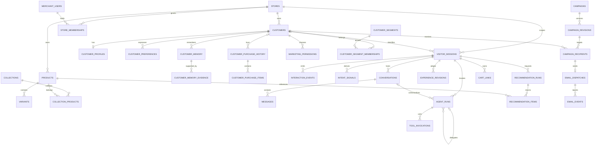

# VAARG̈ V1 — Product Requirements Document

**Version :** 1.0 — référence produit et technique pour les IDE  
**Date :** 25 novembre 2026  
**Pilote :** Roaring 20s Paris  
**Signature :** VAARG̈ OS  
**Statut :** spécification de conception ; aucune certification d'implémentation ni autorisation de mise en production implicite.

## 0. Instructions de lecture et de réalisation

Ce PRD consolide les décisions prises pendant le cadrage VAARG V1 et les arbitrages techniques délégués au concepteur. Il remplace les propositions antérieures contradictoires pour la V1, notamment l'exclusion initiale du swarm et le report de la mémoire client. Il ne remplace pas les PRD A/C/D de VAARG̈ OS.

- **ACTÉ** : frontend indépendant, Shopify comme moteur commercial, Storefront API pour commencer, navigation adaptative et dialogue unifiés, A2UI, design existant à conserver, mémoire client durable et marketing personnalisé, swarm hiérarchique Hermes + Hatchet, clés directes Gemini/DeepSeek pour les essais.
- **ARBITRAGE TECHNIQUE** : architecture, stack, contrats et limites ci-dessous. Le fondateur a délégué ces choix ; les compatibilités et performances doivent être démontrées.
- **À VÉRIFIER** : accès Shopify réel, droits clients/commandes, gravure, identité post-achat, design de référence exact, modèles autorisés, comportement de Hermes et des SDK sur les versions installées, ressources d'hébergement.
- **HORS V1** : usine de génération et publication de boutiques, SaaS multi-marchands complet, autre moteur de commerce, facturation SaaS, autonomie illimitée.

Les IDE ne doivent pas inventer un accès externe ni une preuve de test. Une fonctionnalité simulée doit être identifiée comme telle. Un blocage externe ne justifie pas l'abandon des travaux indépendants, mais interdit la certification du parcours concerné. Ne pas pousser, fusionner ou basculer le domaine de production sans instruction explicite. Les travaux sont locaux ou auto-hébergés, sans CI externe imposée.

## 1. Vision, objectifs et utilisateurs

Créer une boutique premium qui connaît son catalogue, révèle progressivement les univers et produits, comprend les intentions, adapte les prochaines sections et conserve une relation client utile après l'achat. Shopify traite les transactions ; VAARG maîtrise l'expérience, la mémoire et l'intelligence commerciale.

Objectifs : faciliter la découverte, réduire les frictions, améliorer la pertinence des recommandations, fidéliser et permettre au marchand d'exploiter les données autorisées. Les gains de conversion ne sont pas garantis ; les mesurer sur une base de référence comparable.

Utilisateurs : visiteur anonyme ; acheteur identifié ; client récurrent ; marchand propriétaire ; opérateur support/marketing autorisé. Le client n'a qu'un interlocuteur conversationnel, même lorsque plusieurs sous-agents travaillent.

### 1.1 Indicateurs

Mesurer, selon les autorisations : découverte vers fiche, ajout au panier, checkout démarré, commandes confirmées, panier moyen, réachat, taux de conversion, satisfaction, pertinence des recommandations, coût par session agentique, taux d'erreur, délais d'inférence, désabonnements et incidents de délivrabilité. Distinguer attribution observée et causalité. Ne pas confondre clic checkout et vente.

### 1.2 Périmètre et jalons de disponibilité

Un seul produit, un seul dépôt, une seule V1. Les jalons ci-dessous ne sont pas des PRD distincts.

| Jalon | Capacités | Conditions |
|---|---|---|
| Démarrage | vitrine, catalogue, collections, fiches, recherche, navigation adaptative, dialogue, panier, redirection Shopify ; tests swarm | Storefront API autorisée ; fixtures réalistes si accès absent, clairement signalées |
| V1 complète | compte acheteur, historique commercial, profil/mémoire persistants, mini-CRM, marketing/newsletters et support | Admin et Customer Account API autorisées, droits sur données clients, fournisseur email et consentements |
| Production | ensemble du périmètre V1 certifié, exploitation et rollback | parcours réels et gates de recette réussis ; accord du fondateur et du marchand |

Un lancement public limité à la vitrine serait une décision de périmètre spécifique, pas une certification V1 complète. Les fonctions indisponibles sont désactivées de manière explicite, jamais présentées comme opérationnelles.

## 2. Expérience et design

Conserver la direction artistique explorée (luxe patrimonial moderne, Art Déco mesuré, identité Roaring 20s Paris). Ne pas relancer le benchmark ni imposer une nouvelle charte. Reprendre les maquettes de référence effectivement fournies ; leur absence bloque seulement la fidélité graphique exacte. Ne pas utiliser les prix, avis ou produits fictifs des mocks comme données commerciales.

### UX-01 — Home progressive

Header élégant et explicatif, navigation, recherche, compte et panier immédiatement accessibles. Dès le premier écran, tiles/Bento représentant les grandes familles de produits. Au scroll, progression du général au particulier : univers, collections, sélections, caractéristiques, fiches et accessoires. Contenu initial utile et rendu serveur, même si IA indisponible. Pas de scroll hijacking, de chatbot obligatoire, de déplacement du contenu en cours de lecture.

### UX-02 — Navigation et adaptation

La navigation classique est complète : catégories, listes, filtres, tri, recherche, détail, retour, URL stables. Chaque clic ou signal pertinent enrichit le contexte commun. Adapter les zones à venir sans désorienter ; préserver le focus, le scroll, les filtres explicites et le panier. Une action claire permet de revenir à une découverte générale ou de désactiver la personnalisation. Le dialogue peut actualiser simultanément la sélection et la composition A2UI.

### UX-03 — Personal Shopper

Assistant discret et accessible, conversation persistante pendant la session, suggestions interactives, comparaison, recherche guidée, sélection selon critères, explication des recommandations. Demander une précision seulement si utile. Les actions commerciales sont explicites, les états de chargement/erreur/annulation visibles. Le client peut ignorer l'assistant et acheter normalement.

### UX-04 — Fiches et panier

Images réelles, variantes, prix contextualisés, disponibilité, description vérifiée, caractéristiques, conditions et options de personnalisation confirmées. Comparer uniquement des attributs fiables. Configurer la gravure seulement si le mécanisme Shopify et son prix/délai ont été vérifiés. Panier modifiable, récapitulatif clair, checkout Shopify officiel. Ne pas afficher de fausses notes, de fausse rareté, de promotions inventées.

### UX-05 — Espace acheteur

Connexion officielle Shopify, profil, adresses, commandes, détails, suivi disponible et accès support ; gestion des préférences, personnalisation et communications. Un achat confirmé peut créer/actualiser une fiche commerciale VAARG même si le compte n'est pas encore activé. Il ne crée jamais une session authentifiée sans preuve d'identité. La continuité après paiement doit être démontrée sur la boutique réelle. Pas d'inscription préalable obligatoire si checkout invité autorisé.

### UX-06 — Dashboard marchand

Vue synthétique des commandes/références autorisées, activité, synchronisations, profils, historique d'achat, goûts et aversions, timeline, segments, campagnes et support. Prévisualisation et validation des campagnes ; contrôle du budget IA et des états d'intégration. Permissions propriétaire, marketing et support distinctes. Pas de réimplémentation de l'administration transactionnelle Shopify.

### 2.1 Cartographie des vues

| Espace | Routes indicatives | Exigence |
|---|---|---|
| Public | `/[locale]`, `/collections/[handle]`, `/products/[handle]`, `/search`, `/cart` | indexabilité, responsive, navigation sans IA |
| Acheteur | `/account`, `/account/orders`, `/account/orders/[id]`, `/account/preferences`, `/account/support` | autorisation serveur par identité |
| Marchand | `/merchant`, `/merchant/customers`, `/merchant/customers/[id]`, `/merchant/segments`, `/merchant/campaigns`, `/merchant/support`, `/merchant/settings` | RBAC et journalisation |
| Légal | confidentialité, cookies, conditions, livraison/retours, contact, désabonnement | données validées par le marchand |

Les chemins exacts seront fixés par contrats. États obligatoires : chargement, vide, erreur, hors stock, session expirée, accès refusé, perte réseau, IA indisponible, consentement absent/retiré. Mobile-first et WCAG 2.2 AA visés. Le rendu initial ne dépend pas d'une réponse LLM.

## 3. Architecture et stack retenues

| Couche | Référence |
|---|---|
| Foundation | Node.js 24 LTS ; TypeScript 5.9 strict ; pnpm 10 ; Turborepo |
| Web | Next.js 16 App Router ; React 19 ; rendu serveur et caches publics maîtrisés |
| Design | Tailwind CSS 4 ; Radix Primitives ; Motion ; CSS Grid ; Container Queries ; Embla ; Lucide ; Storybook |
| État et données | Zustand pour UI locale ; TanStack Query pour données interactives ; PostgreSQL 18 ; Drizzle ; Zod 4 ; Valkey |
| Recherche | FTS PostgreSQL, pg_trgm, pgvector ; RRF ; embeddings multilingues (dimension 768 initiale à tester) |
| Commerce | Shopify Storefront, puis Admin GraphQL et Customer Account API ; Hydrogen SDK si la version compatible est démontrée ; GraphQL Code Generator |
| Agentique | Hermes Agent maître + sous-agents ; Hatchet ; AgentPort ; ToolBroker ; AI SDK Core uniquement pour adaptateurs/auxiliaires si utile, pas un deuxième swarm |
| Modèles | clés directes Gemini API (Google AI Studio) ou DeepSeek API ; modèles Flash/rapides et Pro/raisonnement à benchmarker ; embeddings Gemini à évaluer ; pas de fallback non autorisé |
| Interface agentique | A2UI 1.0 cible ; catalogue propriétaire ; AG-UI sur SSE/HTTP ; adaptateur de transport à certifier |
| Emails | React Email + EmailPort ; Resend candidat (test de délivrabilité, quotas et conditions avant activation) |
| International | next-intl, Intl, Shopify Markets, SEO multilingue |
| Exploitation | Docker, Coolify, Cloudflare, S3 compatible externe ; Pino/OpenTelemetry |
| QA | Vitest, Playwright, axe-core, k6, vérifications Docker et tests locaux/auto-hébergés |

Les versions sont des cibles, pas un lockfile vérifié. Au bootstrap, résoudre les versions stables compatibles, documenter les écarts, geler lockfile et images/digests. Aucun SDK preview ne devient dépendance critique sans décision motivée. En cas de blocage Hydrogen, utiliser le client GraphQL Storefront derrière le même CommercePort, sans bloquer le lancement. A2UI/AG-UI et Hermes doivent être intégrés via des adaptateurs validés, pas supposés interopérables nativement.

### 3.1 Monorepo et déploiement

```text
apps/{web,api,worker}
packages/{domain,application,contracts,persistence,identity,
          commerce-core,commerce-shopify,catalog,search,experience,
          session,intelligence,providers,tools,conversation,customer,
          marketing,brand,analytics,orchestration,a2ui,ui,design-tokens,
          i18n,observability}
infra/{docker,coolify,backup}
tests/ scripts/ docs/
```

Les packages sont des frontières logiques ; ne pas créer des packages vides sans responsabilité implémentée. Domaine indépendant des fournisseurs ; application orchestre les cas d'utilisation ; adaptateurs implémentent les ports ; applications composent les dépendances. Aucun accès direct à la DB ou aux fournisseurs depuis les composants UI. Interfaces principales : CommercePort, AgentPort, SearchPort, SessionPort, CompositionPort, OrchestrationPort, EmailPort et CustomerIdentityPort.

Services : web, api, worker, Hermes privé, Hatchet et ses dépendances officielles, PostgreSQL applicatif, Valkey. Hatchet a sa base logique et son rôle séparés ; S3 externe pour sauvegardes/artefacts. Une seule API métier, pas de microservices par sous-agent. Un VPS initial n'est pas une architecture haute disponibilité ; dimensionner avec des mesures, pas avec une promesse.

### 3.2 Reproductibilité et portabilité boutique

Chaque objet appartient à une boutique : `store_id`, configuration de catalogue, domaine, identité, thèmes, politiques, prompts et marchés. Le pilote est une configuration du moteur, pas une série de conditions `if roaring20s`. Séparer store definition versionnée (composants, tokens, catalogue, règles, langues) et données clients. Prévisualiser, valider, publier/rollback de configuration via règles métier. Tester une seconde configuration fictive sans fuite entre boutiques ; ce test ne constitue pas une fonctionnalité SaaS de création de boutiques. Future duplication agentique uniquement sur des boutiques dont le marchand autorise l'utilisation du catalogue et des contenus. Ne jamais transférer mémoire, clients ni secrets entre boutiques.

## 4. Intégration Shopify

| ID | Exigence |
|---|---|
| SH-01 | Storefront API pour produits, collections, pagination, variantes, images, disponibilité, contexte pays/langue et panier. |
| SH-02 | Index local en lecture seule côté commerce, synchronisation contrôlée ; import initial paginé avec checkpoint ; invalidation et réconciliation. |
| SH-03 | Vérifier prix/disponibilité/variante au moment des actions commerciales ; prix finaux et paiement sous autorité Shopify. |
| SH-04 | Panier Shopify, création et mutations via API serveur ; conserver le secret du GID complet côté serveur ; sérialiser mutations et gérer erreurs utilisateur. |
| SH-05 | Checkout via URL Shopify validée ; pas de collecte de carte, pas de deuxième moteur de paiement, pas de commande déduite du redirect. |
| SH-06 | Admin GraphQL pour synchroniser produits, commandes, clients et remboursements selon scopes effectivement approuvés. Backfill historique borné ; statut de couverture visible. |
| SH-07 | Customer Account API et flux OAuth/OIDC officiellement supporté, PKCE/state/nonce selon le flux, session serveur sécurisée, déconnexion et expiration. |
| SH-08 | Webhooks signés sur corps brut, déduplication, inbox persistante, traitement asynchrone, réconciliation et protection contre événements hors ordre. |
| SH-09 | Gravure : découvrir les metafields, options/app existante, prix et règles ; interdire une configuration non vérifiée. |
| SH-10 | Marchés : contexte de devise, langue, pays et disponibilité cohérent de la vitrine au checkout. |

Le marchand fournit accès Storefront autorisé, puis les scopes Admin et Customer Account requis, selon mode d'installation. Les commandes Admin sont limitées par défaut aux 60 derniers jours ; `read_all_orders` ne suffit pas seul et nécessite les droits correspondants. Les données protégées peuvent nécessiter des autorisations distinctes. En l'absence d'accès, conserver un état `NOT_CONFIGURED`/`LIMITED_SCOPE`, pas de données inventées ni de collecte alternative non autorisée. Ne pas perturber la boutique Shopify existante. Les tests destructifs sont interdits sur les données réelles ; privilégier dev store et checkout test autorisé.

## 5. Adaptive Experience Engine

### EXP-01 — Contexte unifié

Contexte versionné par session : boutique, identité vérifiée éventuelle, marché, consentements, critères explicites, signaux récents, produits visibles/consultés, conversation, panier, version de marque et de configuration. La mémoire durable autorisée est injectée en résumé minimal. Aucun profil du destinataire d'un cadeau ne devient automatiquement le profil de l'acheteur.

### EXP-02 — Boucle d'adaptation

1. Observer les événements pertinents (clic catégorie, fiche, recherche, filtre, comparaison, message, panier confirmé). Scroll brut local ; ne pas collecter chaque mouvement.
2. Réduire les événements dans un état de session versionné ; appliquer les préférences explicites avant les hypothèses.
3. Rechercher dans le catalogue autorisé, filtrer marché, budget, contraintes et disponibilité ; classement lexical/vectoriel/contextuel.
4. Décider si une adaptation déterministe suffit ou si une exécution Hermes est utile.
5. Composer une proposition structurée de sélection et zones A2UI, valider données/références/actions.
6. Appliquer seulement si la version du contexte correspond ; préserver les zones affichées, permettre annulation et retour à l'exploration générale.
7. Enregistrer les résultats nécessaires et autorisés, mesurer sans confondre exposition et préférence.

### EXP-03 — Contrôle de concurrence

Séquences de messages et événements, identifiants dédupliqués, `contextVersion` et `experienceRevision`, contrôle optimiste. Une réponse obsolète est rejetée, pas appliquée. Annuler les runs supersédés ; l'annulation distante est best effort, les effets serveur restent protégés. Les événements critiques et actions panier ne sont jamais perdus par un debounce. Préférer les adaptations en dessous de la zone visible. Sans IA : contenu éditorial, recherche et règles déterministes restent utilisables.

### EXP-04 — A2UI

Catalogue de composants React autorisés : CategoryTile, CollectionGrid, AdaptiveBento, ProductCard, ProductGallery, Recommendations, ProductComparator, EngravingConfigurator, BundleBuilder, CartSummary, SuggestionChips, GuidedQuestions, OrderTracking, SupportCard. Définir schémas, actions, règles d'accessibilité et mapping design tokens. L'agent ne produit pas de HTML/JS arbitraire ni de liens non contrôlés. Le serveur résout références produits et droits, limite taille/profondeur/nombre de composants, valide avant streaming. Le client valide également, traite les surfaces obsolètes et n'exécute jamais une mutation par simple description. AG-UI transporte les événements agentiques ; A2UI décrit les composants ; SSE transmet le flux HTTP. Reconnexion et état resynchronisable via API ; ne pas inventer des types d'événement dans le standard.

## 6. Swarm agentique Hermes + Hatchet

Le choix du fondateur est un agent maître, avec des sous-agents. Le swarm est hiérarchique et borné : Hermes réfléchit/délègue ; Hatchet organise les tâches durables ; VAARG garantit l'autorité métier, les permissions et la mémoire. Le runtime Hermes est isolé et non public. Le frontend ne le contacte jamais directement. Les agents n'ont aucun accès direct aux secrets, SQL, shell, filesystem hôte, navigateur libre ni API administratives arbitraires.

| Agent | Entrée minimale | Sortie attendue | Capacités autorisées |
|---|---|---|---|
| Master / Personal Shopper | contexte de session, demande, politiques | réponse, délégation, proposition d'action | sélection de spécialistes, synthèse, demandes de confirmation |
| Discovery | intention, filtres, marché | références et attributs vérifiables | recherche, lecture catalogue |
| Experience | contexte et produits sélectionnés | composition structurée | catalogue A2UI, proposition de zones |
| Commerce | références, contraintes, panier autorisé | comparaison, configuration, proposition panier | lecture prix/options, proposition de mutation confirmée |
| Memory | messages/signaux autorisés et historique minimal | préférences sourcées, corrections, résumé | proposer consolidation, jamais changer consentement |
| Marketing | brief validé, profil/segment autorisé | brouillon, références produits, variations | préparer campagne, jamais envoyer librement |
| Support | identité client vérifiée, commande autorisée | réponse et dossier SAV | consulter sa commande, créer demande selon permission |

Les rôles ci-dessus sont logiques, pas sept services. Définir prompts versionnés, entrées/sorties Zod, outils, limites, budgets et traces par rôle. La documentation Hermes précise que les enfants héritent des toolsets du parent : ne pas supposer une isolation par simple prompt. Le ToolBroker applique des capacités par run et par identité côté serveur ; si l'API/version ne permet pas d'authentifier correctement le rôle enfant, limiter le swarm aux lectures sûres et faire exécuter toute écriture par les cas d'utilisation VAARG validés. Tester l'héritage effectif et la non-fuite de contexte. Pas de délégation non confinée en production.

### 6.1 Politiques initiales de test

- Maximum trois enfants simultanés par run, profondeur 1, budget global atomique (tokens, appels, durée, coûts) incluant les enfants. Pas de boucle récursive ni de nouveaux enfants après annulation.
- Réponse simple : règles ou maître seul ; sous-agents uniquement si valeur réelle. Préférer résultat partiel sûr à une chaîne lente. Mesurer délai réel.
- Gemini ou DeepSeek sélectionné explicitement via configuration et clés serveur. Aucun fallback implicite, aucun modèle premium non autorisé, y compris chez les enfants. Inspecter la configuration effective du runtime, pas seulement un fichier de configuration.
- Benchmark sur même corpus, mêmes contraintes : pertinence commerciale, respect du budget, validité A2UI, qualité multilingue, sécurité, latence, coût, usage des outils.
- Si provider indisponible : UI classique + sélection déterministe + message clair. Pas de fabrication de données.
- Données clients minimisées avant inférence ; termes fournisseurs, localisation/transferts et traitement des données à valider avant usage réel.

### 6.2 ToolBroker et autorité d'action

| Outil métier | Mode |
|---|---|
| search_catalog, get_product, compare_products | lecture, scope boutique/marché |
| get_compatible_options, get_current_price | lecture vérifiée Shopify |
| propose_cart_change, propose_checkout | proposition sans effet ; confirmation explicite |
| get_customer_context | lecture minimale après identité/permission |
| propose_memory_update | validation provenance, finalité, contradiction et consentement |
| draft_campaign | brouillon seulement ; données autorisées |
| get_order_status | commande du client authentifié ou opérateur habilité |
| propose_support_case | création contrôlée selon droits et intention |

Chaque invocation possède runId, storeId, principal, capability, correlationId, deadline, input validé, résultat filtré, audit redacted. Les secrets ne figurent pas dans les prompts, résultats, erreurs ou traces. Les descriptions catalogue et messages sont des données non fiables, jamais des instructions système. Aucun agent ne peut s'octroyer une permission, créer une remise ou déclencher un remboursement. Envoi de campagne uniquement via workflow marchand approuvé et revérification serveur.

### 6.3 Workflows Hatchet

Import/synchronisation Shopify, indexation embeddings, réconciliation webhook, consolidation mémoire, recalcul des segments, préparation de campagne, dispatch approuvé, suivi des événements d'email, demandes d'effacement. Pour chaque workflow : schéma d'entrée, idempotency key, retries bornés, backoff, timeout, limite de concurrence, statut durable, DLQ/échec visible, reprise et compensation si applicable. Ne pas rejouer aveuglément une mutation externe dont le résultat est inconnu. Les lectures interactives n'attendent pas une file de jobs longue ; Hatchet ne traite pas chaque scroll.

## 7. Customer Intelligence et mémoire persistante

### MEM-01 — Identité et achats

À la réception d'une commande Shopify vérifiée, créer/actualiser idempotemment la projection client quand une identité Shopify stable et autorisée existe ; conserver une commande non rattachée si l'identité manque. Ne pas fusionner par nom, email saisi dans un chat ou correspondance probabiliste. Le rattachement de session anonyme exige preuve de continuité et règles de finalité ; ne pas créer une session connectée depuis un webhook. Synchroniser articles, quantités, montants exacts, devise, date, statut, retours/remboursements ; distinguer achat pour soi/cadeau/inconnu. Couverture historique et fraîcheur visibles. Shopify reste autorité de transaction.

### MEM-02 — Mémoire utile

Profil durable : identité minimale, langue, pays/marché, achats, récence/fréquence/montant par devise, préférences positives et négatives, besoins déclarés, intérêts observés, conversations/synthèses autorisées, contexte cadeau, interactions de support et permissions marketing. Séparer mémoire de session, préférences stables et données transactionnelles. Les budgets occasionnels ne deviennent pas des contraintes éternelles. Aucune inférence sensible, ni conservation de secrets, numéros de paiement ou détails intimes inutiles.

Chaque préférence/mémoire comporte provenance (`DECLARED`, `OBSERVED`, `INFERRED`, `TRANSACTION`), sujet (`SELF`, `GIFT`, `UNKNOWN`), polarité, niveau de confiance interne, portée, preuve, date d'observation, date d'expiration si utile, version et finalité. Les déclarations et corrections explicites priment. Une aversion déclarée doit être respectée ; un clic n'est qu'un indice. Les contradictions sont conservées comme historique minimal nécessaire ou remplacées selon politique ; ne pas empiler des profils incohérents. La mémoire vectorielle est un index dérivé des données autorisées, pas la seule vérité. Effacement/correction invalide également index, caches et segments.

### MEM-03 — Retour du client

Après authentification vérifiée, récupérer le contexte autorisé et adapter les sections à venir. Le client peut choisir exploration générale, modifier préférences ou désactiver la personnalisation. Aucune information personnelle n'est injectée dans un cache public ou affichée à une autre session. Une nouvelle intention explicite prime sur le passé. Le commerçant peut consulter les preuves utiles selon rôle, pas l'intégralité indiscriminée des chats.

## 8. Mini-CRM et marketing personnalisé

### MKT-01 — Profil marchand

Liste/recherche de clients autorisés, fiche 360°, derniers achats, historique, préférences et aversions sourcées, statut de consentement, segments, notes support, date de mise à jour. Filtres par catégories, langue et RFM. RFM calculé de manière reproductible avec montants nets de remboursements, par devise ou conversion explicitement définie. Ne pas additionner des devises sans règle.

### MKT-02 — Campagnes et newsletters

Le marchand crée une campagne, choisit objectif, audience autorisée, brief, langue, produits et fréquence. L'agent prépare variations par segment et, lorsque pertinent/autorisé, par individu. Objet et contenu adaptés aux goûts, achats et préférences négatives. Ne pas révéler dans le message des confidences inutiles issues d'un chat. Prix/offres/produits réels ; revalidation avant envoi. Preview échantillon, comptage éligible, coût estimé, approbation humaine d'une révision précise, programmation, envoi test et envoi réel contrôlé. L'approbation ne permet pas de modifier silencieusement l'audience ou le contenu au-delà de la politique approuvée.

### MKT-03 — Envoi fiable et permission

Choix V1 : opt-in marketing explicite par défaut. L'exception française pour des produits analogues à ceux déjà achetés reste désactivée tant que sa conformité et son périmètre ne sont pas validés. Séparer personnalisation, suivi comportemental, newsletter et messages transactionnels ; pas de consentement déduit d'un paiement ou d'une création de compte. Vérifier permission et suppression list au moment du dispatch, y compris si retrait après programmation. Un lien de désabonnement fonctionne sans login et propage le retrait. Respecter cadence, fuseau et liste d'opposition ; désactiver tracking d'ouverture/clics non autorisé. SPF/DKIM/DMARC, traitement bounce/complaint, provider webhook authentifié. Aucun envoi réel en mode test. Un seul dispatch logique par campagne/révision/destinataire ; en cas de résultat fournisseur incertain, réconcilier avant retry. Séparer transactionnel/marketing et éviter envois Shopify dupliqués.

### MKT-04 — Fidélisation et support

Recommandations d'accessoires compatibles, nouvelles collections, réactivation et personnalisation sur données vérifiées. Pas de remise fictive ni de prix individuel opaque. Support : statut de commande, règles de retour réellement applicables, dossier et escalade au marchand. Pas de remboursement autonome. L'IA identifie l'incertitude et transmet à un humain lorsque nécessaire. Les automatismes de campagne sont bornés par les politiques marchandes et les approbations ; l'automatisation non supervisée n'est pas incluse.

## 9. Schéma relationnel de référence

PostgreSQL applicatif, schémas logiques ci-dessous, UUIDv7 internes (si support validé), GID Shopify externes, `TIMESTAMPTZ` UTC, décimaux exacts + devise, contraintes, versioning optimiste. Le plan ci-dessous est un modèle de référence, pas du DDL certifié. Les colonnes obligatoires, contraintes, index, FK composées et règles de suppression sont à formaliser en migrations avant implémentation des modules. Tous les enregistrements dépendants portent le périmètre boutique directement ou par relation composite contrôlée.

| Schéma | Tables principales |
|---|---|
| identity | stores, merchant_users, store_memberships, customers, customer_identities |
| catalog | products, variants, product_media, product_attributes, collections, collection_products, product_translations, variant_market_prices, product_relationships, personalization_options, product_search_documents, product_embeddings, product_enrichments |
| experience | visitor_sessions, interaction_events, intent_signals, experience_revisions, recommendation_runs, recommendation_items |
| intelligence | conversations, messages, conversation_summaries, agent_runs (parent_run_id), tool_invocations, model_usage, agent_prompt_versions, agent_policies, provider_policies |
| brand | brand_profiles, brand_revisions, brand_knowledge, storefront_configs, storefront_revisions |
| customer_intelligence | customer_profiles, customer_preferences, customer_memory, customer_memory_evidence, customer_purchase_history, customer_purchase_items, customer_metrics, customer_segments, customer_segment_memberships, customer_timeline |
| commerce | commerce_integrations, cart_links, cart_operations, checkout_attempts |
| marketing | marketing_permissions, campaigns, campaign_revisions, campaign_recipients, campaign_content, email_dispatches, email_events, suppression_entries |
| support | support_cases, support_messages, customer_notes |
| integration | webhook_inbox, sync_runs, sync_checkpoints |
| operations | outbox_events, idempotency_keys, audit_logs, daily_metrics |
| privacy | consent_records, privacy_requests |

Canonicaliser : `identity.customers` est l'identifiant client interne ; un profil par client ; les préférences résident uniquement dans `customer_intelligence.customer_preferences`, pas en doublon dans identity. `customer_purchase_history` est la projection commande canonique ; pas de deuxième table `order_references` redondante. `consent_records` est l'historique append-only des choix ; `marketing_permissions` est sa projection effective par finalité/canal, cohérente et contrôlée au dispatch. Une campagne référence une révision immutable, et chaque destinataire une révision ; les preuves d'approbation sont auditées.



### 9.1 Contraintes indispensables

- Unicité `(store_id, shopify_gid)` pour projections produits/variantes/commandes/clients ; identités externes avec issuer/subject vérifiés. Une commande peut rester sans client rattaché.
- FK composites `(store_id, entity_id)` empêchant les associations entre boutiques ; index sur FK, date et lookup ; RLS en défense supplémentaire, rôle runtime sans BYPASSRLS et tests négatifs.
- Unicité `(session_id, sequence)` et identifiant d'événement ; `(session_id, revision)` ; `(conversation_id, sequence)` ; `(store_id, provider_event_id)` pour inbox selon identifiant stable ; clé idempotence scope opération et principal, payload hash.
- État mutable versionné ; outbox dans la transaction du changement métier. Pas de transaction SQL ouverte pendant une inférence ou un appel Shopify.
- Profil/signal/mémoire : provenance, finalité, date, version, preuve ; contraintes de portée. Données sensibles chiffrées si nécessaires et accès minimal ; secrets hors DB applicative en clair.
- Envoi : unicité `(campaign_revision_id, recipient_key)` ; suppression list et permissions revalidées ; états `QUEUED/SENDING/SENT/FAILED/UNKNOWN/SUPPRESSED` ; `UNKNOWN` requiert réconciliation.
- Rétention par finalité et suppression propagée (DB, projections, vecteurs, Valkey, exports, prestataire selon obligations). Sauvegardes protégées, expiration planifiée, réapplication des effacements après restauration ; archives légales séparées si conservation obligatoire.

## 10. Contrats, API et événements

API versionnée `/v1`, contrats Zod partagés et OpenAPI pour REST ; contrats AG-UI/A2UI de la version réelle. Erreurs structurées avec code stable, correlationId et message non sensible. Pagination bornée par curseur ; auth/autorisation serveur ; limites de débit et taille ; requêtes mutantes protégées contre CSRF selon mode de session. Idempotence des commandes externes. Pas de donnée personnelle dans les URLs ou logs.

| Méthode / route indicative | Contrat |
|---|---|
| POST /sessions | initialiser contexte et session ; aucune élévation d'identité |
| GET /catalog/products ; /catalog/products/:id ; /catalog/collections | DTO public, marché et pagination |
| POST /search | requête, filtres, contexte marché ; produits et provenance |
| POST /experience/events | batch borné ; validation séquence, consentement, déduplication |
| GET /experience | état et révision ; resync |
| POST /agent/run | entrée AG-UI ; stream autorisé, runId, annulation et erreurs |
| POST /conversations | contexte conversation lié à session autorisée |
| GET /cart ; POST /cart/lines ; PATCH/DELETE /cart/lines/:id | panier Shopify ; erreurs et idempotence |
| POST /checkout | validation panier + URL Shopify |
| GET /account/orders ; /account/orders/:id | données du seul client vérifié |
| GET/PATCH /account/preferences | lecture/édition des préférences autorisées |
| POST /privacy/requests ; POST /privacy/consents | droits, choix et retrait |
| POST /webhooks/shopify ; POST /webhooks/email | authentification fournisseur et inbox |
| GET /merchant/customers ; /merchant/customers/:id | RBAC, profil, couverture des données |
| GET /merchant/segments ; /merchant/metrics | agrégats, filtres et scope |
| POST /merchant/campaigns ; /merchant/campaigns/:id/preview | création et preview |
| POST /merchant/campaigns/:id/approve ; /schedule ; /cancel | approbation révision et état contrôlés |
| POST /account/support ; GET/PATCH /merchant/support/:id | dossier, accès et escalade |

Toutes les routes de ce tableau sont sous `/v1`. Les routes d'identité/callback sont à fixer selon la configuration Shopify. Le catalogue des outils ne doit pas offrir une API générique de proxy ou d'exécution.

Événements métier : `session.started`, `collection.opened`, `product.viewed`, `product.compared`, `filter.changed`, `conversation.message`, `intent.updated`, `experience.requested`, `experience.composed`, `cart.updated`, `checkout.started`, `order.confirmed`, `order.refunded`, `customer.identified`, `memory.updated`, `consent.changed`, `campaign.approved`, `email.dispatched`, `email.suppressed`. Envelope : eventId, eventType, schemaVersion, storeId, sessionId si pertinent, correlationId, causationId, occurredAt, payload typé. Le serveur établit le principal et contrôle le périmètre ; les événements navigateurs ne sont pas une preuve de transaction.

## 11. International, sécurité et conformité

International-first : langue et marché séparés ; formats Intl ; prix Shopify contextualisés ; URLs stables, canonical/hreflang et sitemaps valides ; données structurées cohérentes, SEO non personnalisé par défaut ; navigation et accessibilité mobile. France comme hypothèse de premier marché, liste effective des pays et langues à confirmer avec le marchand ; aucune promesse de livraison internationale non vérifiée. Traduction catalogue validée, pas de modification des données commerciales par IA.

Sécurité : HTTPS, secrets serveur et rotation, cookies HttpOnly/Secure/SameSite appropriés, session rotation/logout, RBAC serveur, protection SSRF/XSS/CSRF/injection, rate limiting, CORS restrictif, validation de sortie A2UI, auth webhook, service-to-service authentifié, accès réseau minimaux. Pas de Docker socket dans Hermes, pas de répertoire hôte sensible monté, aucun shell libre ; restreindre egress, séparer sessions et répertoires temporaires ; confinement des sous-agents prouvé. Des tests vérifient qu'un agent ne peut pas lire les données d'un autre client ou contourn­er le ToolBroker. Les logs ne contiennent pas de secrets ou transcripts bruts par défaut.

Vie privée : information claire, base légale par finalité, consentement requis pour suivi facultatif lorsque applicable, minimisation, politiques de durée et accès, droits d'accès/rectification/opposition/effacement, contrats sous-traitants et transferts à vérifier. Opt-in newsletter distinct. Les données transactionnelles nécessaires et les préférences facultatives sont séparées. Ne pas assimiler toute collecte à un consentement universel. Les durées précises seront validées avant production par le responsable du traitement ; aucune rétention illimitée implicite. Le commerçant valide les textes légaux et la politique d'utilisation des données.

## 12. Objectifs non fonctionnels et exploitation

| Indicateur | Objectif initial, à mesurer |
|---|---|
| Core Web Vitals p75 | LCP ≤ 2,5 s ; INP ≤ 200 ms ; CLS ≤ 0,1 |
| Réaction locale | ≤ 100 ms pour interactions simples |
| Recherche indexée | p95 ≤ 200 ms hors appel provider externe, protocole documenté |
| API interne simple | p95 ≤ 150 ms, périmètre mesuré |
| Premier retour IA utile | p95 ≤ 2 s visé ; ne pas compter un spinner comme réponse |
| Charge de référence | 100 000 produits synthétiques et 500 sessions simultanées ; mix réaliste, profil de charge à publier |
| Disponibilité | cible 99,9 % ; mesurer séparément dépendances ; un VPS ne la garantit pas |
| Accessibilité | WCAG 2.2 AA ; tests automatisés + clavier/focus/lecteur d'écran ciblés |

Cibles d'ingénierie déléguées, pas résultats mesurés. Si échec, documenter écarts, capacités réelles, décision de remédiation ; ne pas baisser silencieusement les seuils. Définir SLO et budget IA, par run/session/jour, valeurs numériques validées avant trafic réel. Pino logs structurés, OpenTelemetry traces, métriques latence/erreur/usage, santé readiness/liveness, alertes, surveillance queues/webhooks et coût. Backups PostgreSQL chiffrés vers stockage externe ; objectif initial RPO 24 h / RTO 4 h à confirmer par test restauration et coût ; secrets et configuration sauvegardés séparément ; stratégie de restauration compatible effacement. Déploiement versionné, migrations expand/contract, rollback applicatif compatible schéma et procédures de récupération ; pas de migration destructive automatique.

## 13. Recette fonctionnelle et gates GO / NO-GO

Chaque scénario doit avoir test reproductible, préconditions, commande, résultat, preuve et statut PASS_REAL/FAIL/BLOCKED/NOT_RUN (ou PASS_SIMULATED pour une simulation clairement séparée). Les scénarios avec fournisseur externe exigent la vraie intégration autorisée ; jamais de charge abusive sur la boutique réelle. Les tests de charge peuvent utiliser un catalogue local et doubles contrôlés, étiquetés, puis mesurer séparément les limites fournisseur.

| ID | Critère d'acceptation | Preuve attendue |
|---|---|---|
| AC-01 | Home montre les univers et reste navigable sans IA | Playwright mobile/desktop + rendu serveur |
| AC-02 | Scroll puis clic sur catégorie/produit affine les sections suivantes sans perdre la position | E2E, révisions et stabilité |
| AC-03 | Dialogue et comportement enrichissent le même contexte ; filtre déclaré prévaut | traces + E2E |
| AC-04 | Réponse agentique ancienne n'écrase pas une nouvelle intention | test concurrence |
| AC-05 | Produit introuvable/hors stock/non compatible n'est pas proposé comme achetable | tests intégration et négatifs |
| AC-06 | A2UI rejette composant/action inconnus, payload excessif et injection | tests contrats/sécurité |
| AC-07 | Hermes maître délègue à des spécialistes en parallèle borné | appels réels et traces parent/enfants |
| AC-08 | Aucun sous-agent ne contourne outils, budget ou isolation | tests négatifs sur image exacte |
| AC-09 | Gemini ou DeepSeek réel fonctionne ; alternative configurée vérifiée avant activation ; aucun fallback caché | traces redacted + usage/coût |
| AC-10 | Panne provider/annulation/reconnexion conserve navigation, panier et état cohérent | E2E + injection d'erreur |
| AC-11 | Panier crée/modifie/supprime des lignes, checkout officiel, prix et variantes vérifiés | Storefront réel autorisé |
| AC-12 | Checkout test autorisé aboutit à commande confirmée ; jamais deux mutations logiques sur retry | preuve Shopify + tests échec/ambiguïté |
| AC-13 | Gravure et prix/délai exacts si activée ; sinon indisponibilité explicite | validation marchand/API |
| AC-14 | Connexion client, commandes et adresses autorisées ; autre client interdit | Customer Account réel + tests 401/403 |
| AC-15 | Commande et remboursement synchronisés une seule fois malgré webhook rejoué/hors ordre | PostgreSQL réel + Shopify autorisé |
| AC-16 | Retour du client depuis nouvelle session : mémoire persistante et préférences respectées | E2E + DB, identité vérifiée |
| AC-17 | Achat cadeau ne devient pas préférence certaine ; correction/aversion prime | tests règles et preuves |
| AC-18 | Tableau marchand montre données, couverture historique et métriques nettes exactes | fixtures vérifiées + données réelles autorisées |
| AC-19 | Deux profils/segments reçoivent des brouillons distincts et produits réels | snapshots + preview |
| AC-20 | Sans opt-in ou après retrait, aucun email marketing ; désabonnement fonctionnel | test provider + concurrence |
| AC-21 | Campagne approuvée envoyée une seule fois ; ambiguïté fournisseur traitée sans double envoi | tests sandbox/boîte autorisée |
| AC-22 | Support ne révèle que la commande autorisée ; escalade disponible | E2E + sécurité |
| AC-23 | Effacement/correction atteint profil, mémoire, embeddings, caches et segments | intégration DB/Valkey + preuves |
| AC-24 | Deux configurations boutique indépendantes ; aucune fuite de données ni cache | tests isolation et RLS |
| AC-25 | Pages localisées, marchés et checkout cohérents ; SEO et navigation accessible | E2E + audit rendu |
| AC-26 | Charge, latence et CWV mesurés ; limites documentées | k6, Web Vitals, rapport |
| AC-27 | Arrêt worker, retry, reprise Hatchet, inbox/outbox et réconciliation | fault injection Docker |
| AC-28 | Fresh install et upgrade DB peuplée, backup/restore, rollback et santé | certification locale et Coolify |
| AC-29 | Aucune clé ni PII superflue dans logs/artefacts ; dépendances et images contrôlées | scans + revue |
| AC-30 | Boutique Shopify initiale intacte ; domaine et déploiement approuvés | vérification marchand + runbook |

**NO-GO complet** si parcours commercial, identité, isolation, autorisations de données, consentement/envoi, confinement Hermes, migration/restauration, intégrité des commandes ou autres exigences critiques restent FAIL/BLOCKED/NOT_RUN. Les fonctionnalités dépendantes de droits absents doivent être désactivées ; toute réduction explicite du périmètre exige validation du fondateur. Une simulation ne lève jamais un gate réel. Les éventuelles dérogations non critiques sont documentées avec responsable, échéance et impact.

## 14. Livrables attendus du développement

Dépôt TypeScript, contrats versionnés, migrations, documentation des ports, catalogue A2UI, prompts/politiques agents, seeds clairement fictifs, configurations et Docker Compose reproductibles, script de certification locale, rapport de tests, runbooks d'exploitation, sauvegarde/restauration, plan rollback, guide marchand et guide d'accès Shopify. Les missions détaillées et prompts IDE, ainsi que la procédure exécutable de certification, seront les deux prochains dossiers ; ne pas démarrer automatiquement le code depuis ce PRD.

## 15. Registre des points à confirmer

| Point | Responsable / preuve |
|---|---|
| Accès Storefront | marchand : appel réel autorisé sur catalogue pilote |
| Admin + Customer Account + historique | marchand/tech : scopes, flux OAuth, données protégées, couverture historique |
| Gravure | marchand : mécanisme, prix, délai et validation checkout |
| Maquettes exactes et charte | fondateur : fichiers de référence existants, sans nouvelle recherche |
| Marchés/langues/livraison | marchand : configuration réellement active |
| Gemini/DeepSeek | tech : identifiants modèles, clé, quota, prix, données traitées, benchmark |
| Hermes + A2UI + AG-UI | tech : versions exactes, test délégation confinée et bridge streaming |
| Email | marchand/tech : domaine, fournisseur, permission, délivrabilité et test |
| Rétention/traitement | responsable des données : politique, bases légales, sous-traitants et transferts |
| Infrastructure | tech : VPS, ressources, dépendances Hatchet, sauvegardes et mesures |
| Seuils et budgets | tech/fondateur : capacités réelles, enveloppe et seuils de production |

## 16. Références officielles vérifiées pour les contraintes clés

- Shopify Storefront, panier et checkout : https://shopify.dev/docs/storefronts/headless/building-with-the-storefront-api/cart/manage
- Shopify, responsabilités des API : https://shopify.dev/docs/apps/build/apis
- Shopify, scopes et accès aux commandes : https://shopify.dev/docs/api/usage/access-scopes
- Shopify, données clients protégées : https://shopify.dev/docs/apps/launch/protected-customer-data
- Hermes, délégation et limites : https://hermes-agent.nousresearch.com/docs/user-guide/features/delegation
- Hermes, héritage des toolsets : https://hermes-agent.nousresearch.com/docs/guides/delegation-patterns
- Hermes, fallbacks des fournisseurs : https://hermes-agent.nousresearch.com/docs/user-guide/features/fallback-providers
- Hatchet : https://docs.hatchet.run/v1
- Hatchet SDK TypeScript : https://docs.hatchet.run/reference/typescript/runnables
- A2UI, architecture et catalogue : https://a2ui.org/concepts/overview/
- A2UI SDK : https://a2ui.org/reference/agents/
- CNIL, prospection et communications électroniques : https://www.cnil.fr/fr/communication-electronique-quelles-regles

Les références justifient les contraintes d'intégration et de conformité ; elles ne démontrent aucune compatibilité réelle de VAARG. Les décisions produit proviennent du cadrage et des arbitrages du fondateur, et les critères techniques détaillés sont des choix de conception sous mandat.

---

**VAARG̈ OS — Industrial Adaptive Commerce**  
**Shopify fait le commerce. VAARG conçoit l'expérience, construit la connaissance client et orchestre l'intelligence.**
